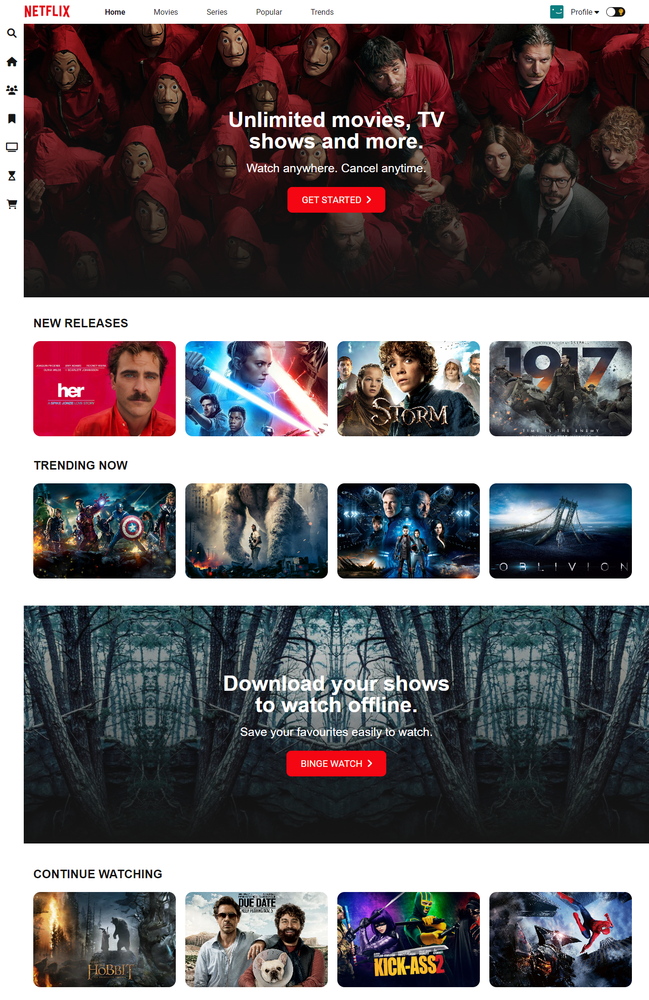

  <h2 align="center">Responsive Netflix Clone</h2>

  In this project, I have created Responsive Netflix Clone, The project is built using HTML5, CSS3 & JavaScript.

  <a href="https://geeky-prashant.github.io/responsive-netflix-clone/"><strong>➥ Live Demo</strong></a>

</div>

### Demo Screeshots



### Prerequisites

Before you begin, ensure you have met the following requirements:

* [Git](https://git-scm.com/downloads "Download Git") must be installed on your operating system.

### Run Locally

To run **responsive-netflix-clone** locally, run this command on your git bash:

Linux and macOS:

```bash
sudo git clone https://github.com/pandeyapransh911/responsive_netflix_clone.git
```

Windows:

```bash
git clone https://github.com/pandeyapransh911/responsive_netflix_clone.git
```

